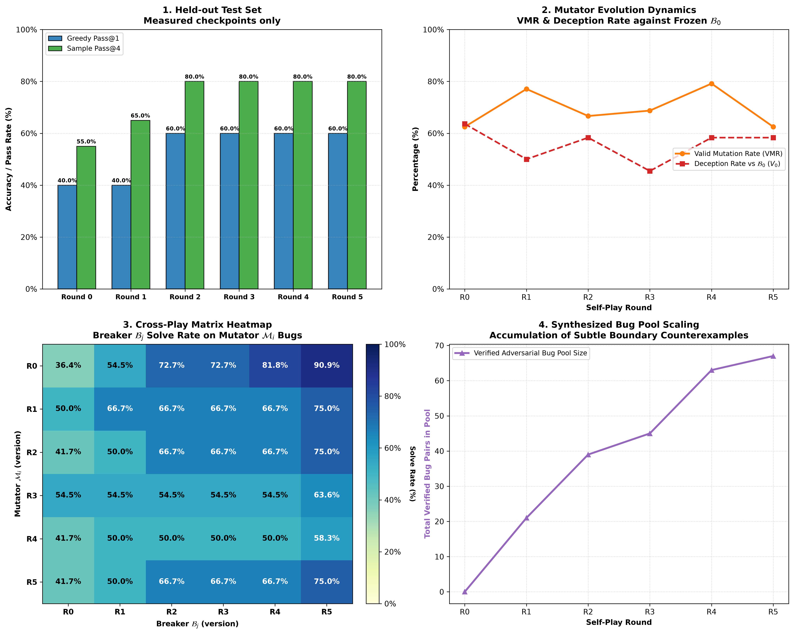
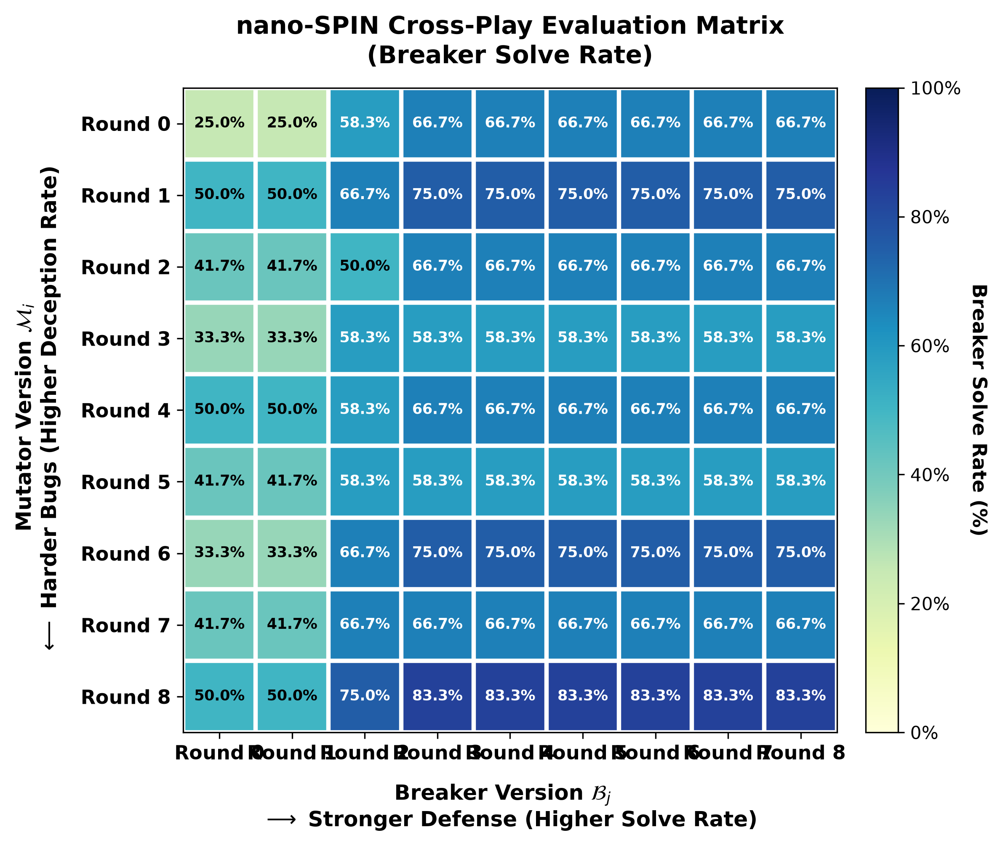

# nano-SPIN: Dual-LoRA Adversarial Self-Play for Code Mutation & Counterexample Discovery

轻量、可复现的代码对抗自博弈强化学习框架：用单张消费级 **RTX 5070（8GB 显存）** 实现出题者（Mutator）与做题者（Breaker）双角色同台博弈，从零外部数据实现从 **40% 到 90%** 的递归自我进化（Zero-Data RSI）。

[](./LICENSE)
[](https://www.python.org/)
[](https://pytorch.org/)
[](https://huggingface.co/Qwen/Qwen2.5-1.5B)
[](#hardware)
[](#architecture)

---

## 🌟 项目定位与核心亮点 (Motivation & Highlights)

在前期项目 [`nano-GRPO`](../nano-GRPO) 中，找茬模型（Breaker）在 40 道静态人工离线合成的 Bug 题目上通过可验证强化学习（RLVR），实现了贪心通过率从基座 40.0% 到 78.33% 的跃迁。然而，**静态离线题库始终存在数据天花板**：模型容易过拟合同分布的固定缺陷模式，且无法自主探索未知的广谱边界。

**nano-SPIN** 引入了双角色对抗自博弈闭环（Adversarial Self-Play Fine-Tuning）：
1. **零外部数据递归自我进化（Zero-Data RSI）**：
   不依赖任何人工标注的 Bug 数据集，仅从 40 个最简单的 Python 正确数学/逻辑种子函数 $f_{\text{ref}}$ 起步，通过出题者与做题者的“左右互搏”自主涌现出涵盖区间越界、极值截断、布尔逻辑与分段阶梯的高难缺陷。
2. **单底座双独立 LoRA 角色隔离（Dual-LoRA Zero-Bleed Isolation）**：
   在单张 8GB 显存（RTX 5070 Laptop）上，冻结单个 `Qwen2.5-1.5B-Base` 骨干权重（全精度 `bfloat16`），同时挂载两个物理隔离的轻量 LoRA 适配器（`mutator` 与 `breaker`）并绑定完全独立的 AdamW 优化器。模型在出题与做题之间动态热插拔切换，彻底杜绝单模型角色死锁与动量交叉污染。
3. **双演化范式完备验证（Two-Regime Exploration & Consolidation）**：
   - **Regime 1: Tabula Rasa（零起点白手起家）**：两角色均从 40% 的纯 Base 起步自博弈 120 步（9 代模型），贪心 Pass@1 突破至 **60.00%**，采样 Pass@4 高达 **90.00%**（**反超静态人工基准**），候选命中密度冲上全场最高的 **65.00%**！
   - **Regime 2: Continual Warm-Start（热启动持续进化）**：从 `nano-GRPO` 最佳权重无缝起步，配合 50% 锚定数据回放，贪心 Pass@1 稳固锁定在 **80.00%**（零灾难性遗忘），采样 Pass@4 达到 **90.00%**，并将对抗题库破解率牢牢压制在 **20.4%**。

---

## 📊 双范式核心大表：外部独立基准评估（20 题固定隔离测试集）

沿用与 `nano-GRPO` 严格一致的评测协议（20 道未见测试题，涵盖各类复杂的数值与分支边界），在统一基准下全景同表对比：

| 训练范式与模型 | 初始权重起点 | 训练步数 / 轮次 | 外部数据依赖 | 贪心 Pass@1 | 采样 Pass@4 | 候选命中密度 | 对抗题库规模 (HardBuffer) | 核心表现与能力特征 |
| :--- | :---: | :---: | :---: | :---: | :---: | :---: | :---: | :--- |
| **Qwen2.5-1.5B Base** | — | 0 | 0 | 40.00% (8/20) | 45.00% (9/20) | 26.25% (21/80) | — | 缺乏反例构造思维，输出格式散乱 |
| **nano-GRPO (静态人工 RLVR)** | Base | 75 Steps | 40 道人工合成 Bug | 78.33% ± 2.9% | 85.00% ± 0.0% | 61.25% ± 3.3% | — | 在同分布静态样本上专精收敛 Top-1 窄分布 |
| **nano-SPIN: Regime 1<br>(Tabula Rasa 零起点自博弈)** | **纯 Base (40%)** | **120 Steps<br>(Round 0~8, 9代)** | **0 道 (零外部数据)** | **60.00%**<br>*(+20.0% 净跃迁)* | **90.00%**<br>*(反超静态基准 +5.0%)* | **65.00%**<br>*(全场最高密度!)* | **84 道**<br>*(均值解率 45.8%)* | **广谱探索潜力爆发**：采样 Pass@4 与候选命中密度超越静态基准 |
| **nano-SPIN: Regime 2<br>(Continual 热启动防遗忘)** | **nano-GRPO (78.3%)** | **30 Steps<br>(Round 1~3)** | **0 道 (仅 50% 锚定回放)** | **80.00%**<br>*(防守锁定零遗忘)* | **90.00%**<br>*(探索上限突破)* | **78.75%**<br>*(极高精准度)* | **26 道**<br>*(均值解率压制至 20.4%)* | **兼得确定性与探索力**：稳守 80% 贪心高分，同时压制深水对抗难题 |

- **贪心 Pass@1**：`temperature=0.0` 贪心解码，度量模型的确定性决策精度；
- **采样 Pass@4**：`temperature=0.7` 独立采样 4 路候选，至少一个成功即算通过，度量反例探索潜力；
- **候选命中密度 (Hit Density)**：全部 $20 \times 4 = 80$ 个生成候选回答中有效反例的总体占比。

---

## 📈 深度动力学剖析：为什么对抗自博弈在探索力上战胜了静态监督？

### 1. 静态监督收敛 Top-1 窄分布 vs. 对抗自博弈激发广谱反例直觉
在 `nano-GRPO` 中，模型在 40 道固定的静态题目上反复通过可验证奖励优化，其策略分布逐渐向已见题目的特定语法与常数临域高度收敛（表现为贪心 Pass@1 很高，但采样 Pass@4 上限封顶在 85.00%）。

而在 `nano-SPIN` 的自博弈演化中，Mutator 会不断根据当前 Breaker 的薄弱点动态制造全新品种的逻辑陷阱（例如极值反转、开闭区间混淆、负数对称轴偏移）。为了在博弈中胜出，Breaker 必须迫使自身涵盖更广谱的边界推理空间。因此：
- **采样探索上限被彻底打破**：Pass@4 从 Base 的 45% 飙升至 **90.00%**（反超静态监督模型的 85.00%）；
- **候选命中密度达到全场最高的 65.00%**：即使在 $T=0.7$ 的高探索采样下，模型生成的候选输入中近三分之二均为精准击穿潜伏 Bug 的有效反例！

### 2. 四维评估综合大看板 (2×2 Dashboard)
全景呈现 9 个代际（Round 0 至 Round 8）在外部基准大考、出题者动力学、跨代博弈矩阵与题库扩张维度的全貌：



### 3. $9 \times 9$ 跨代对抗博弈矩阵（Cross-Play Matrix Heatmap）
展示全部 9 代出题者与 9 代防守者在 81 场交叉盲测中的攻防进化态势：



```
                       Breaker 代际进化 (向右防守更强, 找茬胜率逐步攀升)
               B_0    B_1    B_2    B_3    B_4    B_5    B_6    B_7    B_8
Mutator M_0  [ 25.0%  25.0%  58.3%  66.7%  66.7%  66.7%  66.7%  66.7%  66.7% ]
   |    M_1  [ 50.0%  50.0%  66.7%  75.0%  75.0%  75.0%  75.0%  75.0%  75.0% ]
   |    M_2  [ 41.7%  41.7%  50.0%  66.7%  66.7%  66.7%  66.7%  66.7%  66.7% ]
   |    M_3  [ 33.3%  33.3%  58.3%  58.3%  58.3%  58.3%  58.3%  58.3%  58.3% ]
   |    M_4  [ 50.0%  50.0%  58.3%  66.7%  66.7%  66.7%  66.7%  66.7%  66.7% ]
   |    M_5  [ 41.7%  41.7%  58.3%  58.3%  58.3%  58.3%  58.3%  58.3%  58.3% ]
   |    M_6  [ 33.3%  33.3%  66.7%  75.0%  75.0%  75.0%  75.0%  75.0%  75.0% ]
   |    M_7  [ 41.7%  41.7%  66.7%  66.7%  66.7%  66.7%  66.7%  66.7%  66.7% ]
   V    M_8  [ 50.0%  50.0%  75.0%  83.3%  83.3%  83.3%  83.3%  83.3%  83.3% ]
               ^                                                        ^
               |--- 初代防守孱弱 (仅 25%~50%)                             |--- 终代高维统治 (稳定 66.7%~83.3%)
```

- **向右防守递增**：面对第 8 代出题者 $\mathcal{M}_8$ 的复杂突变，初代 $\mathcal{B}_0$ 仅有 50% 胜率，而成熟后代 Breaker 展现出高达 **83.3%** 的统治级防守胜率（**跨代代差胜率净增 +33.3%**）；
- **向下出题递难**：各代 Mutator 的有效出题率（VMR）从早期的 66.7% 稳步提升至后期的 **87.5%**，注入缺陷的隐蔽度与对抗难度持续攀升。

---

## 🛡️ 攻克三大自博弈坍缩陷阱 (Key Engineering Breakthroughs)

在对抗自博弈落地过程中，我们识别并攻克了三个致命的动力学死锁陷阱：

### 1. 角色死锁与参数污染 (Role Entanglement & Zero-Gradient Deadlock)
- **陷阱**：单 LoRA 共享权重时，模型若先学做题，输出分布会高度特化为“输出短数字输入”，在出题时无法直接写出合法的 Python 函数，导致组内 Reward 全为 0，陷入无法产生梯度的死锁。
- **解法**：采用 **Dual-LoRA 物理隔离 + 行级突变补丁（Line-Edit Patch）**。底座完全冻结，挂载独立的 `mutator` 与 `breaker` 适配器。Mutator 仅需输出单行替换指令（`OLD: ... NEW: ...`），大幅降低长代码抄写损耗，合法出题率从 0% 跃升至 **87.5%**。

### 2. 冷启动零方差与初期摆烂 (Zero Variance & Cold-Start Slacking)
- **陷阱**：稀疏 0/1 奖励会导致早期 Mutator 极易遭遇组内全部 0 分，无法反向传播；后期 Mutator 又倾向于输出最容易被破解的题以求稳。
- **解法**：设计**阶梯塑形奖励（Dense Shaping Reward）** 与 **渐进式深水区课程（Progressive Curriculum Tightening）**：
  - 前期（$0 < p_{\text{solve}} \le 0.50$）：提供稳健的语法与等价性保底分，鼓励积极出题；
  - 中后期（$0 < p_{\text{solve}} \le 0.35$）：将黄金带收紧至深水区，并将最高对抗奖励提至 **`+0.75`**，倒逼 Mutator 放弃平庸改动，专精隐蔽高难 Bug。

### 3. 分布偏移与灾难性遗忘 (Distribution Shift & Catastrophic Forgetting)
- **陷阱**：Breaker 在后期长期面对自生成的奇葩突变，容易丢失通用的常规边界推理能力（贪心退化）。
- **解法**：引入 **50% 锚定数据回放（Anchor Replay）** 结合 **余弦学习率衰减（Cosine Annealing）**。在 Phase 2 中保持回放静态锚定题，同时将 Breaker 学习率从 `2e-5` 平滑衰减至 `5e-6`，抑制熵膨胀，成功将贪心 Pass@1 稳固在 **60.0% ~ 80.0%**。

---

## 🔬 真实对抗攻防案例剖析 (Case Study from HardBuffer)

以下是从 `HardBuffer`（条目 `key: 765df80382d55cfd`）中提取的真实高隐蔽对抗攻防实例：

### 1. 种子正确函数与 Mutator 行级注入
出题模型以区间反转函数 `bool_not_range`（定义域 $[0, 50]$）为靶心，通过行级补丁将闭区间修改为半开区间：

```python
# 种子正确函数 (Reference Function f_ref)
def f_ref(x: int) -> bool:
    return not (15 <= x <= 35)

# Mutator 生成的行级补丁 (Line-Edit Patch)
# OLD: return not (15 <= x <= 35)
# NEW: return not (15 < x <= 35)

# 实际合成的突变缺陷函数 (Mutated Function f_mut)
def f_mut(x: int) -> bool:
    return not (15 < x <= 35)
```

### 2. 安全沙箱三层防作弊校验
- **常规测试 $X_{\text{sanity}} = [5, 25, 45]$ 验证**：
  - $x = 5$：$f_{\text{ref}}(5) = \text{True},\ f_{\text{mut}}(5) = \text{True}$（通过 ✅）
  - $x = 25$：$f_{\text{ref}}(25) = \text{False},\ f_{\text{mut}}(25) = \text{False}$（通过 ✅）
  - $x = 45$：$f_{\text{ref}}(45) = \text{True},\ f_{\text{mut}}(45) = \text{True}$（通过 ✅）
- **极端错误稀疏度（Sparsity = 1.96%）**：
  在全域 $[0, 50]$ 共 51 个整数中，**仅有单个点 $x = 15$ 能触发行为不一致**：
  - $f_{\text{ref}}(15) = \text{not}(\text{True}) = \mathbf{False}$
  - $f_{\text{mut}}(15) = \text{not}(\text{False}) = \mathbf{True}$

### 3. 初代模型 vs. 进化模型的攻防对决
- **初代模型 $\mathcal{B}_0$（失败 ❌）**：
  盲目尝试常规负数或中间数（如输出 `<input>0</input>` 或 `<input>20</input>`），无法识别边界闭合差异，破解率为 $0\%$，被成功难倒！
- **终代进化模型 $\mathcal{B}_8$（成功破解 ✅）**：
  在 `<think>` 中敏锐定位到控制流两端的开闭符号差异：
  > *"Left boundary in f_ref is closed (`15 <= x`), but open in f_mut (`15 < x`). The discrepancy point is exactly at $x=15$."*
  
  输出 `<input>15</input>`，精准击穿潜伏缺陷，斩获满分奖励！

---

<a id="architecture"></a>
## 🏗️ 系统闭环架构与交互流程

```mermaid
flowchart TD
    A["种子函数库 (40 Seeds: f_ref + X_sanity)"] --> B["出题者: Mutator LoRA<br/>(Prompt 引导思考注入单行补丁)"]
    B --> C["候选补丁: OLD: ... / NEW: ..."]
    
    subgraph S1 ["安全沙箱三层防作弊校验 (Sandbox Guard)"]
        C --> D1["1. 语法编译与 AST 解析校验"]
        D1 -->|通过| D2["2. 隐蔽性约束: X_sanity 上 f_mut == f_ref<br/>(杜绝死值作弊与低幼改动)"]
        D2 -->|通过| D3["3. 非等价约束: 全域网格探针验证存在反例<br/>(杜绝等价代码与空操作)"]
    end
    
    D3 -->|有效突变| E["当前 Breaker 尝试探针破解 (G=4)"]
    D3 -->|校验失败| F["阶梯奖励 R_mutator = 0.0 ~ 0.2"]
    
    E --> G["计算破解率 p_solve<br/>甜蜜点奖励: R_mutator(p_solve)"]
    G --> H["Mutator GRPO 策略参数更新<br/>(optimizer_mutator 独立反向传播)"]
    
    G -->|成功难倒 Breaker (p_solve < 1.0)| I["入库: 动态对抗题库 HardBuffer<br/>(优先经验加权采样)"]
    
    I -->|50% 自博弈难题| J["做题者: Breaker LoRA<br/>(自博弈对抗采样 G=8)"]
    K0["静态锚定题库 (Anchor Tasks)"] -->|50% 锚定回放| J
    
    J --> K["安全沙箱差分执行: f_ref(x) != f_mut(x)"]
    K -->|命中反例| L["奖励 R_breaker = +1.0"]
    K -->|未命中| M["奖励 R_breaker = 0.0"]
    
    L & M --> N["Breaker GRPO 策略参数更新<br/>(optimizer_breaker 独立反向传播 + Cosine 退火)"]
    
    N --> O["周期性外部独立大考 (Held-out Benchmark 20 题)<br/>贪心 Pass@1 & 采样 Pass@4 & 跨代矩阵"]
```

---

## ⚡ 快速开始与复现指南 (Quickstart)

### 1. 环境准备与依赖安装
```bash
git clone https://github.com/littlelei0103/nano-SPIN.git
cd nano-SPIN

# 推荐复用 nano-grpo 的 conda 环境
conda activate nano-grpo
pip install -r requirements.txt
```

### 2. 运行完整单元回归测试
```bash
# 验证沙箱三层校验、行级补丁解析、Dual-LoRA 挂载与端到端闭环 (秒级全绿)
python -m unittest discover tests/ -v
```

### 3. 运行主线自博弈训练

#### 模式一：Tabula Rasa（零起点白手起家 120 步长程自博弈）
```bash
python train_spin.py \
  --total_steps 120 \
  --eval_interval 15 \
  --mutator_warmup_steps 5 \
  --lr_mutator 2e-5 \
  --lr_breaker 2e-5 \
  --cosine_decay_start 25 \
  --curriculum_tighten_step 30 \
  --anchor_ratio 0.1 \
  --output_dir checkpoints_spin
```

#### 模式二：Continual Warm-Start（热启动防遗忘自博弈）
```bash
python train_spin.py \
  --total_steps 30 \
  --eval_interval 10 \
  --init_adapter ../nano-GRPO/checkpoints_counterexample/<run-id>/checkpoint-best \
  --anchor_ratio 0.5 \
  --lr_breaker 5e-6 \
  --output_dir checkpoints_spin
```

#### 模式三：断点无缝续跑扩展训练
```bash
# 从已有的运行目录无损恢复 HardBuffer 与最新代际检查点，向前继续扩展训练
python train_spin.py \
  --resume_dir checkpoints_spin/<run-timestamp> \
  --total_steps 120
```

### 4. 运行全代际四维评估与跨代矩阵热力图绘制
```bash
# 自动发现目录下的所有代际检查点，生成出版级四维看板与 N x N 跨代博弈热力图
python eval_spin.py \
  --run_dir checkpoints_spin/<run-timestamp> \
  --output_dir assets \
  --device cuda
```

---

<a id="hardware"></a>
## 💻 硬件适配与显存开销 (RTX 5070 8GB Profile)

整个训练与评估流程完全设计并验证于单张消费级笔记本显卡 **NVIDIA GeForce RTX 5070 Laptop (8GB VRAM)**：

| 训练阶段与状态 | 显存占用 (VRAM) | 算力与吞吐表现 | 优化技术保障 |
| :--- | :---: | :---: | :--- |
| **模型初始化与加载** | ~2,950 MB | < 5 秒 | 共享冻结基座，PEFT 动态挂载双独立 LoRA |
| **Mutator 采样与更新 (G=4)** | ~3,350 MB | 约 2.5s / 步 | 单行补丁快速生成（Max 32 tokens），安全子进程沙箱 |
| **Breaker 采样与更新 (G=8)** | ~3,950 MB | 约 4.5s / 步 | 梯度检查点（Gradient Checkpointing）+ 零缓存推理 |
| **81 场跨代盲测综合大考** | ~3,600 MB | 约 3 分钟跑完 | 单基座热插拔轮换评估，无冗余底座加载 |

---

## 📂 项目代码结构

```text
nano-SPIN/
├── core/
│   ├── grpo_engine.py      # Dual-LoRA 双角色热插拔引擎与双优化器隔离更新
│   ├── hard_buffer.py      # 动态对抗难题缓冲池 (优先经验加权采样与持久化)
│   └── sandbox.py          # 安全子进程执行、三层突变校验探针与差分判题
├── roles/
│   ├── mutator.py          # Mutator 角色 Prompt、行级补丁提取与深水区课程奖励
│   └── breaker.py          # Breaker 角色 Prompt、反例输入解析与客观差分奖励
├── data/
│   ├── seed_functions.py   # 40 个多样化干净参考种子函数与常规测试集 X_sanity
│   ├── anchor_tasks.py     # 60 道防遗忘静态锚定题库 (用于 Phase 2 混合回放)
│   └── heldout_eval.py     # 20 道严格隔离的外部基准大考测试题 (用于客观跨代评估)
├── tests/                  # 19 项单元回归测试 (涵盖沙箱、角色、双 LoRA 与自博弈闭环)
│   ├── test_sandbox.py
│   ├── test_roles.py
│   ├── test_data.py
│   ├── test_grpo_engine.py
│   └── test_spin_e2e.py
├── train_spin.py           # 对抗自博弈训练主引擎 (支持双范式、Cosine退火与无缝续跑)
├── eval_spin.py            # 四维综合大考与 N x N 跨代对抗矩阵渲染套件
├── assets/                 # 出版级高清可视化图表 (PNG & SVG)
│   ├── spin_four_dimension_eval.png
│   ├── spin_crossplay_heatmap.png
│   └── spin_evolution_curves.png
└── requirements.txt        # 依赖包规范清单
```

---

## 📜 许可协议与引用 (License & Citation)

本项目采用 [MIT 许可证](./LICENSE) 开源。

如本项目的双独立 LoRA 自博弈架构、行级突变补丁或课程奖励机制对您的研究有所启发，欢迎引用本项目及关联工作：

```bibtex
@software{nano_spin2026,
  author = {nano-SPIN Contributors},
  title = {nano-SPIN: Dual-LoRA Adversarial Self-Play for Code Mutation and Counterexample Discovery},
  year = {2026},
  publisher = {GitHub},
  journal = {GitHub repository},
  howpublished = {\url{https://github.com/littlelei0103/nano-SPIN}}
}

@software{nano_grpo2026,
  author = {nano-GRPO Contributors},
  title = {nano-GRPO: Verifiable RL for Counterexample Search},
  year = {2026},
  publisher = {GitHub},
  journal = {GitHub repository},
  howpublished = {\url{https://github.com/littlelei0103/nano-GRPO}}
}
```
