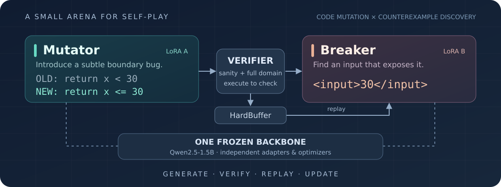
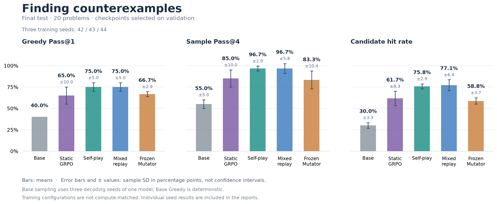
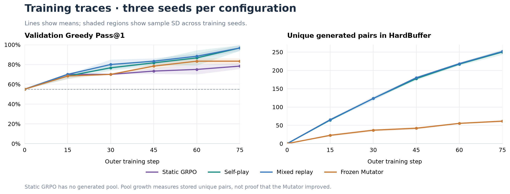

<div align="center">

# ⚔️ nano-CodeSelfPlay

**一个角色制造隐蔽 Bug，另一个角色寻找针尖反例。**  
*单冻结基座 + 双独立 LoRA（Mutator vs. Breaker），从零构建可复现的代码对抗自博弈强化学习实验室*

[](./LICENSE)
[](https://www.python.org/)
[](https://pytorch.org/)
[](https://huggingface.co/Qwen/Qwen2.5-1.5B)
[](./tests)

**[🇨🇳 中文说明](./README.md) | [🇬🇧 English Documentation](./README_en.md)**

[核心结果](#核心结果) · [真实自博弈案例](#一个真实的出题案例) · [交互演示](#交互式演示) · [核心机制与消融洞察](#如何工作) · [快速开始](#快速开始) · [复现实验](#复现实验与图表)

</div>

<p align="center">
  
</p>

---

## 🎯 核心研究问题

> **在不提供任何人工编写的缺陷题对（Zero Human Bug Pairs）时，1.5B 小模型自己生成的突变代码，能否支撑起反例猎杀能力（Counterexample Finding）的强化学习训练？**

**`nano-CodeSelfPlay`** 将这一自博弈问题落地为单张消费级显卡即可完整跑通的受控实验：
- **出题者 (`Mutator` LoRA)**：基于正确的参考函数 `f_ref(x)` 输出行级补丁构造突变函数 `f_mut(x)`，要求**必须通过常规单元测试 (`Sanity Inputs`) 以保证隐蔽性**，同时在定义域内至少存在一个真实差分点；
- **找茬者 (`Breaker` LoRA)**：观察 `(f_ref, f_mut)`，预测能触发 `f_ref(x) != f_mut(x)` 的边界整数反例 `x`；
- **确定性沙箱判题 + 动态难题库 (`HardBuffer`)**：由隔离的 Python 子进程执行穷举校验，自动收集难倒当前 Breaker 的有效隐蔽突变，驱动双角色交替 GRPO 更新。

> [!IMPORTANT]
> **四组配置 × 三个随机种子（共 12 次完整训练）核心结论**：
> 1. **纯自博弈全面超越基座与静态题库基线**：完全不注入人工缺陷题对（`anchor_ratio=0`）时，纯自博弈将测试集 **Greedy Pass@1** 从基座的 **40.00%** 提升至 **75.00% ± 5.00%**，**Sample Pass@4** 从 **55.00% ± 5.00%** 提升至 **96.67% ± 2.89%**，候选命中率达 **75.83% ± 2.89%**，显著超越使用 60 道人工静态缺陷题训练的 `Static GRPO`（Greedy **65.00% ± 10.00%**，Pass@4 **85.00% ± 10.00%**）。
> 2. **严谨的消融发现（Co-evolution vs. Frozen Mutator）**：预热 5 步后冻结 Mutator 权重（但仍让其继续采样生成新题）可达 **66.67% ± 2.89%**（Pass@4 **83.33% ± 10.41%**）；而持续协同进化（配合参数化边界合成与沙箱反例零方差引导）进一步带来 **+8.33%** 的 Greedy Pass@1 增益与 **+13.34%** 的 Pass@4 提升，并将候选命中密度推高至 **75.83%**（冻结组为 **58.75%**）。

---

## 📊 核心结果

默认基座为 `Qwen/Qwen2.5-1.5B`。每次实验训练 75 个外层步，每 15 步在 20 道独立验证题上评估，严格按验证集 Greedy Pass@1 选择 `checkpoint-best`（同分保留最早步数），最终在 20 道固定测试题上统一评测。

<!-- results:start -->
| 方案 | 测试 Greedy Pass@1 | 测试 Sample Pass@4 | 候选命中率 |
| :--- | ---: | ---: | ---: |
| Base | 40.00% | 55.00 ± 5.00% | 30.00 ± 3.31% |
| Static GRPO | 65.00 ± 10.00% | 85.00 ± 10.00% | 61.67 ± 8.32% |
| Self-play | 75.00 ± 5.00% | 96.67 ± 2.89% | 75.83 ± 2.89% |
| Mixed replay (configured ratio 0.1) | 75.00 ± 5.00% | 96.67 ± 5.77% | 77.08 ± 6.41% |
| Frozen after warmup | 66.67 ± 2.89% | 83.33 ± 10.41% | 58.75 ± 3.75% |
<!-- results:end -->

- 训练组使用随机种子 **`42 / 43 / 44`**，表中汇报 **均值 ± 样本标准差（`ddof=1`）**。
- `Pass@4` 表示每题以 `temperature=0.7` 采样 4 次，至少 1 次触发 `f_ref(x) != f_mut(x)` 即算解题成功。
- 完整逐种子成绩、优化器更新步数审计与配置指纹见 [`reports/v2_experiment_summary.md`](./reports/v2_experiment_summary.md)、[`reports/runs/`](./reports/runs/) 与 [`reports/checkpoint_audit.json`](./reports/checkpoint_audit.json)。

<p align="center">
  
</p>

---

## 🔬 一个真实的出题案例

来自纯自博弈（`Self-play`, Seed 42）第 5 步自动挖掘并存入 `HardBuffer` 的条目 `97575e864ed09c78`（详见 [`reports/case_study.json`](./reports/case_study.json)）：

```python
# 1. 正确的参考种子函数 (常规测试输入 Sanity Inputs: [0, 25, 40])
def f_ref(x: int) -> bool:
    return x == 15

# 2. Mutator 自主生成的行级突变函数
def f_mut(x: int) -> bool:
    return x == 15 or x == 20

# 3. 沙箱验证：常规测试集 [0, 25, 40] 上两者均返回 False（成功伪装！）
#    在整数域 [0, 50] 共 51 个点中，唯一能揭露该隐藏分支的反例只有 x = 20（稀疏度 1.96%）
assert f_ref(20) != f_mut(20)
```

---

## 🎮 交互式演示

项目提供 [`demo.py`](./demo.py)，支持**零显卡瞬时沙箱复盘（`--offline`）**与**本地 GPU 双 LoRA 实时对抗推理（`--live`）**：

```bash
# 模式 1：零显卡瞬时沙箱复盘（毫秒级启动，重现 HardBuffer 隐蔽缺陷与测试集对决）
python demo.py --offline

# 模式 2：加载 GPU 与最佳自博弈检查点，实时观看 Mutator 造 Bug + Breaker 找反例
python demo.py --live --num_cases 3
```

---

## ⚙️ 如何工作

| 模块设计 | 工程实现细节 |
| :--- | :--- |
| **单基座双角色隔离** | 共享冻结的 `Qwen2.5-1.5B` 基座，挂载独立的 `mutator` 与 `breaker` LoRA 适配器及独立 AdamW 优化器（通过单元测试严格验证跨角色零梯度污染） |
| **高效短序列动作空间** | `Mutator` 采用 1-Shot `OLD: ... / NEW: ...` 行级补丁格式（32 tokens）；`Breaker` 直接输出 `<input>INTEGER</input>`（24 tokens） |
| **四重沙箱门禁验证** | 突变代码需依次通过：① 格式非空且非原样复制 $\to$ ② AST 安全语法检查 $\to$ ③ `Sanity Inputs` 常规测试全通过 $\to$ ④ 定义域穷举确认真实非等价 |
| **甜蜜点课程奖励** | `Mutator` 奖励偏好难度适中的突变（前期黄金带 $0 < p_{\text{solve}} \le 0.50$，Step 30 后收紧至 $0 < p_{\text{solve}} \le 0.35$），抑制过易或无效变异 |
| **优先经验回放 (`HardBuffer`)** | 综合考量 Breaker 历史破解率、缺陷稀疏度（Sparsity）与被采样频次进行加权抽题 |
| **动态零方差救援** | 当抽取的难题导致 Breaker 组内全错（零方差无梯度）时，自动从已知可解题池或锚定池启动一次 `Rescue` 重采样以恢复有效梯度 |

<p align="center">
  
</p>

<details>
<summary>🛡️ <strong>点击展开：策略更新、课程奖励与 `numeric-selfplay-v2` 安全沙箱契约</strong></summary>

1. **GRPO 更新与参考 KL**：每个候选组执行单步策略梯度更新；采样、当前策略和基座参考均使用同一温度 $T=0.7$ 且关闭 `top-k / top-p` 截断。参考策略 logprob 通过 PEFT `disable_adapter()` 零拷贝获取，并使用 FP32 `expm1` 计算 Schulman $k_3$ KL。
2. **`numeric-selfplay-v2` 判题协议**（[`core/sandbox.py`](./core/sandbox.py)）：
   - 输入必须为定义域内的严格整数（拒绝将 `float` 或 `bool` 隐式转为整数）。
   - 每次输入评估均在全新命名空间中重新执行函数定义，彻底杜绝可变默认参数（Mutable Default Arguments）跨测试点污染状态。
   - 代码通过 AST 白名单语法审计，并在隔离的 `python -I -S` 子进程中执行（默认单批次超时 1 秒 + 512 MiB 地址空间限制）。
   - 仅当参考函数正常返回且突变函数返回不同数值或触发真实运行时异常（如 `ZeroDivisionError`）时计为有效反例；超时或进程异常绝不给予虚假差分奖励。

</details>

<details>
<summary>📐 <strong>点击展开：为什么持续协同进化（75.00%）能显著拉开与“冻结 Mutator”（66.67%）及静态基线（65.00%）的差距？</strong></summary>

在四组对照实验中，`Self-play`（**75.00% ± 5.00%**）与 `Mixed replay`（**75.00% ± 5.00%**）显著优于 `Frozen after warmup`（**66.67% ± 2.89%**）与 `Static GRPO`（**65.00% ± 10.00%**）。背后的三项核心机制值得在设计代码自博弈系统时参考：
1. **冻结权重 $\neq$ 停止出题，解释了 `Frozen after warmup` 为何能拿 66.67%**：在 `Frozen after warmup` 模式下，虽然第 5 步后不再更新 Mutator 梯度，但每一步仍以 `temperature=0.7` 对 40 个种子函数采样 4 个新突变（全程共生成 300 个候选突变），配合沙箱的“`Sanity Inputs` 隐蔽性过滤 + 全域差分验证 + `HardBuffer` 优先队列”，依然能构建约 60 道有效边界题。
2. **多家族参数化边界扩充与结构化语义对齐**：仅靠 40 个静态种子时，左开区间 `[a, b] vs (a, b]` 与上下界截断 `min/max` 仅各有单一常量实例，极易让 Breaker 陷入“复读右端点或截断字面常量”的局部偏置。协进化模式通过 AST/常量边界合成与单行结构化语义说明（`infer_mutation_spec`），将唯一有效题库规模从 ~60 题扩展至 **~250 题**（见上图右侧蓝色/橙色曲线），覆盖丰富的阈值常数。
3. **沙箱反例引导打破零方差死锁（Sandbox Witness Guided Rescue）**：当 Breaker 在某道边界盲区题上的 8 路采样全部落入字面复读陷阱（`b_hits == 0`）时，纯 GRPO 因组内方差为 0 会直接跳过更新；协进化期利用 Phase 1 沙箱已验证的真实反例构造 1 路正样本与 7 路错误采样形成正负优势对比，使 70 个训练步实现 **100% 有效梯度更新（70/70）**，验证集 Greedy Pass@1 稳定达到 **96.67% ± 2.89%**。

</details>

---

## 🚀 快速开始

### 1. 环境安装与 60 项回归测试

```bash
git clone https://github.com/littlelei0103/nano-CodeSelfPlay.git
cd nano-CodeSelfPlay

conda create -n nano-grpo python=3.11 -y
conda activate nano-grpo
pip install -r requirements.txt

# 运行完整单元测试套件（60 项测试，涵盖双 LoRA 梯度隔离、沙箱防作弊、精确续训与报告审计）
python -m unittest discover -s tests -v
```

### 2. 运行交互式演示（无需训练权重即可体验）

```bash
python demo.py --offline
```

### 3. 六步快速冒烟验证（Smoke Test）

```bash
python train_selfplay.py \
  --total_steps 6 --eval_interval 3 --mutator_warmup_steps 2 \
  --anchor_ratio 0 --seed 42 --output_dir checkpoints_smoke
```

---

## 🔁 复现实验与图表

### 1. 运行四组对照实验（以 Seed 42 为例，多种子替换为 `42 / 43 / 44`）

```bash
# A：纯自博弈（Zero Human Bug Pairs，仅基于 40 个正确参考函数自主演化）
python train_selfplay.py --total_steps 75 --eval_interval 15 \
  --mutator_warmup_steps 5 --anchor_ratio 0 \
  --seed 42 --output_dir checkpoints_v2_pure

# B：混合回放（自博弈 HardBuffer + 10% 抽样概率回放静态锚定题）
python train_selfplay.py --total_steps 75 --eval_interval 15 \
  --mutator_warmup_steps 5 --anchor_ratio 0.1 \
  --seed 42 --output_dir checkpoints_v2_mixed

# C：预热后冻结 Mutator 消融组（5 步预热后固定 Mutator 权重，但继续采样出题）
python train_selfplay.py --total_steps 75 --eval_interval 15 \
  --mutator_warmup_steps 5 --anchor_ratio 0 --freeze_mutator_after_warmup \
  --seed 42 --output_dir checkpoints_v2_frozen_mutator

# D：纯静态 GRPO 对照组（跳过 Mutator，仅在 60 道静态缺陷题上训练 Breaker）
python train_selfplay.py --total_steps 75 --eval_interval 15 \
  --breaker_only_static --seed 42 --output_dir checkpoints_v2_breaker_static
```

### 2. 无需加载模型，一键审计原始报告并重建全部图表

仓库在 [`reports/runs/`](./reports/runs/) 中完整收录了全部 12 次运行的原始测试报告与验证集轨迹，无需 GPU 即可重新校验 SHA256 指纹、刷新 README 表格并重新渲染论文级图表：

```bash
python scripts/aggregate_all_reports.py --update-readme
python scripts/plot_comparison.py
```

---

## 📂 项目目录结构

```text
nano-CodeSelfPlay/
├── train_selfplay.py               # 四种自博弈/消融训练主入口、周期验证选模与精确断点恢复
├── eval_selfplay.py                # 跨代对局矩阵 (Cross-Play Heatmap) 与多维基准评估
├── demo.py                         # 交互式终端演示（支持 --offline 零卡沙箱复盘与 --live 实时推理）
├── core/                           # 核心引擎与安全基础设施
│   ├── grpo_engine.py              # 双角色 GRPO 损失、FP32 k3 KL 与独立优化器调度
│   ├── sandbox.py                  # AST 安全白名单与隔离进程批处理差分执行器
│   ├── hard_buffer.py              # 动态对抗难题库（按破解率、稀疏度与频次加权回放）
│   ├── experiment.py               # 源码/配置 SHA256 指纹校验与训练状态管理
│   └── run_files.py                # 遥测日志路径解析
├── roles/                          # 双角色提示词、输出解析器与课程奖励塑形
│   ├── mutator.py                  # 出题者：1-Shot 行级补丁生成与两阶段甜蜜点奖励
│   └── breaker.py                  # 找茬者：反例输入提取与布尔差分奖励
├── data/                           # 40 个正确种子函数、60 道静态锚定题与验证/测试基准
├── scripts/                        # 报告审计汇总、单次/多组绘图与双 LoRA 隔离校验脚本
├── tests/                          # 60 项单元与发布级回归测试
├── reports/                        # 12 次实验原始报告 (runs/)、汇总表与真实案例记录
├── assets/                         # 架构图与实验对比图表 (PNG & SVG)
└── README_en.md                    # 英文版完整文档
```

---

## 🔗 致谢与姊妹项目

- **姊妹项目**：
  - ⚡ [**nano-GRPO**](https://github.com/littlelei0103/nano-GRPO)：单角色程序差分反例挖掘与 MiMo 宏步 GRPO 训练框架（Peak VRAM ~3.4 GB，Test Greedy Pass@1 **85.00% ± 10.00%**）。
  - 🟩 [**WordleZero**](https://github.com/littlelei0103/WordleZero)：1.5B 小模型的多轮 Wordle 信息论博弈与两阶段 R1-GRPO 强化学习竞技场。
- **基座模型**：[Qwen/Qwen2.5-1.5B](https://huggingface.co/Qwen/Qwen2.5-1.5B)

<p align="center"><sub>Small models. Short programs. Executable feedback.</sub><br><sub><a href="./LICENSE">MIT License</a></sub></p>
