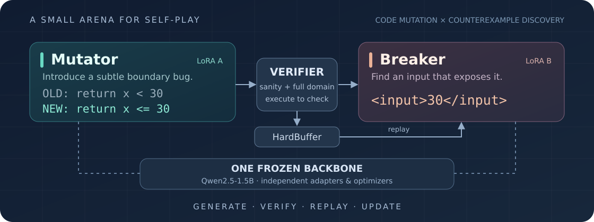
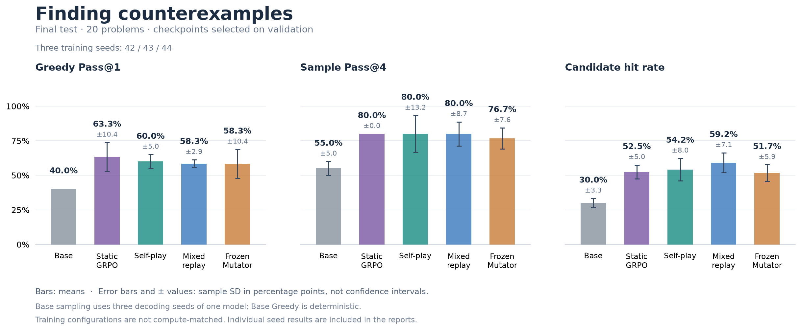
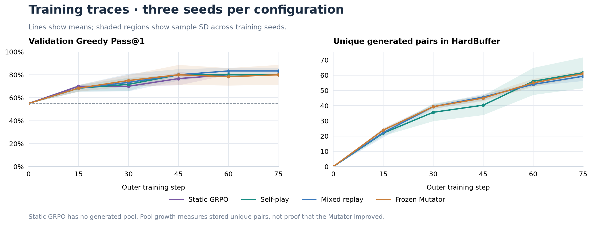

<h1 align="center">nano-CodeSelfPlay</h1>

<p align="center">
  <strong>一个角色制造 Bug，另一个角色寻找反例。</strong><br>
  用一个冻结基座、两个 LoRA，搭建可以亲手拆解的代码自博弈强化学习实验。
</p>

<p align="center">
  <a href="./LICENSE"></a>
  
  
  
  <a href="./tests"></a>
</p>

<p align="center">
  <a href="#核心结果">实验结果</a> ·
  <a href="#一个真实的出题案例">看个例子</a> ·
  <a href="#如何工作">设计亮点</a> ·
  <a href="#快速开始">快速开始</a> ·
  <a href="#复现实验与图表">复现实验</a>
</p>

<p align="center">
  
</p>

**在不提供人工编写的缺陷题对时，模型自己生成的突变题能否支撑反例发现能力的训练？** 本项目将这一问题落地为可控的单卡实验：Mutator 基于正确参考函数构造突变，Breaker 寻找触发二者行为差异的反例输入，受限执行环境提供可验证奖励。

> [!NOTE]
> 已完成 **四种配置 × 三个训练种子** 的对照实验。在不注入静态人工缺陷题对（`anchor_ratio=0`）时，自生成题目训练将测试 **Greedy Pass@1** 从 **40.0%** 提升至 **60.0% ± 5.0%**；60 道人工静态缺陷题训练的结果为 **63.3% ± 10.4%**。
>
> **预热后冻结出题者，仍可获得相近成绩。** 当前规模下，持续更新出题者的额外收益尚不明确；本项目提供一套可复现的自博弈基线与消融记录。

## 核心结果

默认基座为 `Qwen/Qwen2.5-1.5B`。每次训练 75 个外层步，每 15 步在 20 道验证题上评估，以贪心分数选 best，同分保留较早模型；最终评估 20 道固定测试题。

<!-- results:start -->
| 方案 | 测试 Greedy Pass@1 | 测试 Sample Pass@4 | 候选命中率 |
| :--- | ---: | ---: | ---: |
| Base | 40.00% | 55.00 ± 5.00% | 30.00 ± 3.31% |
| Static GRPO | 63.33 ± 10.41% | 80.00 ± 0.00% | 52.50 ± 5.00% |
| Self-play | 60.00 ± 5.00% | 80.00 ± 13.23% | 54.17 ± 8.04% |
| Mixed replay (configured ratio 0.1) | 58.33 ± 2.89% | 80.00 ± 8.66% | 59.17 ± 7.11% |
| Frozen after warmup | 58.33 ± 10.41% | 76.67 ± 7.64% | 51.67 ± 5.91% |
<!-- results:end -->

训练组使用种子 **42 / 43 / 44**，表中为均值 ± **样本标准差（ddof=1）**，不是置信区间。Base 的三个采样种子只重复解码同一个模型；训练组的波动包含训练和最终采样随机性。`Pass@4` 表示每题采样四次，至少一次找到有效反例。

<p align="center">
  
</p>

实验观察与证据边界：

- **自生成题目支撑学习**：在仅提供正确参考函数、不注入人工缺陷题对的纯自博弈设置下，测试集贪心准确率从 Base 的 **40.0%** 提升至 **60.0% ± 5.0%**，与使用 60 道静态缺陷题的 `Static GRPO`（**63.3% ± 10.4%**）均值接近；静态、自博弈和混合回放的 `Pass@4` 均值均为 **80.0%**。
- **持续更新与预热后冻结**：预热 5 步后冻结出题者的贪心均值为 **58.3% ± 10.4%**，持续更新出题者仅高出约 **1.7 个百分点**（本轮三个种子的样本标准差更小）。在当前 40 个短函数与行级替换的动作空间下，尚不足以宣称持续更新出题者是必要条件。
- **数据与泛化边界**：测试题未用于训练或运行内的 checkpoint 选择，但在早期框架探索阶段已被查看过，不构成严格意义的全新盲测。当前评估集规模较小（20 题）且模板相近，尚不包含跨分布或大规模真实代码库的泛化验证。

完整逐种子成绩、配置与来源见 [结果汇总](./reports/v2_experiment_summary.md)、[原始报告](./reports/runs/) 与 [检查点核对记录](./reports/checkpoint_audit.json)。

## 一个真实的出题案例

来自纯自博弈 Seed 42 的 HardBuffer，条目 `97575e864ed09c78`：

```python
# 正确函数
def f_ref(x):
    return x == 15

# Mutator 生成的突变
def f_mut(x):
    return x == 15 or x == 20

# 能揭露差异的输入
assert f_ref(20) != f_mut(20)
```

原种子的常规输入 `[0, 25, 40]` 无法区分两者；在整数域 `[0, 50]` 内，差分点只有 **20**。这个例子展示了“通过常规测试，但仍存在边界缺陷”的任务形式。

[案例原始记录](./reports/case_study.json) 包含代码、常规输入与重新执行验证的差分点。记录中的 `8/44` 是该题最终累计候选命中率，不是某一步的模型成绩；没有逐步回答日志，因此不据此编造能力演进轨迹。

## 如何工作

| 设计 | 实现方式 |
| :--- | :--- |
| **一个基座，两个角色** | 冻结基座，独立 `mutator` / `breaker` LoRA 与 AdamW |
| **短输出动作** | Mutator 输出 `OLD:` / `NEW:` 行级替换；Breaker 输出整数 |
| **执行验证** | 常规输入校验后，穷举该种子的有限整数域，确认存在真实差分 |
| **动态题库** | HardBuffer 按历史命中率、缺陷稀疏度与采样次数回放 |
| **零方差处理** | 全对或全错组跳过更新，必要时尝试一组备用题 |
| **四种实验模式** | 持续自博弈、混合回放、预热后冻结出题者、Breaker-only 静态 GRPO |

<p align="center">
  
</p>

题库扩大不等于出题者变强；冻结出题者仍然采样新题，只是不更新权重。

<details>
<summary><strong>策略更新、课程奖励与判题契约</strong></summary>

每个候选组只更新一次，`old_logprobs` 为更新前当前分布的 detach 值，因此初始重要性比率为 1；这不是多轮 PPO 更新。采样、当前策略和基座参考使用相同温度，关闭 top-k / top-p 截断。基座参考通过 PEFT `disable_adapter()` 获取，使用 FP32 k3 KL。

默认生成上限为 Mutator 32 tokens、Breaker 24 tokens。Mutator 在预热期获得格式、语法与常规测试的塑形奖励；有效突变在前期对 `0 < p_solve <= 0.50` 的组给予较高奖励，Step 30 后收紧到 `0 < p_solve <= 0.35`。`p_solve=0` 也有单独的奖励分支。双方奖励不是严格零和。

协议 `numeric-selfplay-v2`：

1. 输入必须是定义域内的整数，不将 float 或 bool 转成整数。
2. 每次输入都重新执行函数定义，创建全新的命名空间与默认参数，保持批量和单次判题的状态语义一致。
3. 返回值支持 `bool`、`int`、有限 `float`，按 Python 数值相等规则比较。
4. 参考函数必须正常返回。突变返回不同值，或发生真实运行时异常（如除零），可以构成差分。
5. 超时、资源耗尽、进程故障和无法解析的返回结果不提供差分奖励；批次超时会保守拒绝整个突变。

代码通过 AST 受限语法检查，在 `python -I -S` 子进程中执行，默认每批次超时 1 秒；支持 `resource` 的系统还施加 512 MiB 地址空间限制。这是面向小型数值函数的受限执行环境，不是通用的不可信代码托管沙盒。

</details>

<details>
<summary><strong>数据划分、回放比例与跨代分析</strong></summary>

| 数据 | 数量 | 用途 |
| :--- | ---: | :--- |
| 正确种子函数 | 40 | 人工编写的函数与常规输入，供 Mutator 出题 |
| 静态锚定题 | 60 | 静态组训练，以及混合组回放和救援 |
| Validation | 20 | 训练监控与 best 选择 |
| Test | 20 | 选模结束后的固定基准评估 |

静态训练、验证、测试没有相交 ID 或完全相同的函数对，但模板仍相关。`anchor_ratio=0` 表示不注入静态 Bug 题对，不意味着没有人工种子、预训练数据或验证集指导。

`anchor_ratio=0.1` 是抽题概率配置。题库为空或需要救援时也可能使用锚定题，不能把它写成实测有且仅有 10% 的训练候选来自静态题。

[Seed 42 跨代原始报告](./reports/crossplay_seed42.json) 使用训练种子上的新生成突变，衡量双方相互适应，不代表独立分布泛化。每个种子保留第一个有效突变，各行题数可能不同；空题库为 N/A，而不是 0% 胜率。它也不能单独证明 Mutator 持续变强。

</details>

## 快速开始

建议 Linux、Python 3.11 与支持所选 PyTorch 版本的 NVIDIA GPU。CPU 可运行测试，完整训练建议使用 GPU；显存占用随环境与生成配置变化，当前报告未记录可比较的峰值。

```bash
python -m venv .venv
source .venv/bin/activate
pip install -r requirements.txt
python -m unittest discover -s tests -v
```

六步流程检查：

```bash
python train_selfplay.py \
  --total_steps 6 --eval_interval 3 --mutator_warmup_steps 2 \
  --anchor_ratio 0 --seed 42 --output_dir checkpoints_smoke
```

该命令检查生成、优化器更新与保存链路，不验证最终效果。有效梯度仍需要候选组奖励有方差。

## 复现实验与图表

### 训练

以下以 Seed 42 为例；三种子实验分别替换为 42、43、44。

```bash
# A：纯自博弈
python train_selfplay.py --total_steps 75 --eval_interval 15 \
  --mutator_warmup_steps 5 --anchor_ratio 0 \
  --seed 42 --output_dir checkpoints_v2_pure

# B：混合回放
python train_selfplay.py --total_steps 75 --eval_interval 15 \
  --mutator_warmup_steps 5 --anchor_ratio 0.1 \
  --seed 42 --output_dir checkpoints_v2_mixed

# C：预热后冻结 Mutator（仍会持续生成题目）
python train_selfplay.py --total_steps 75 --eval_interval 15 \
  --mutator_warmup_steps 5 --anchor_ratio 0 --freeze_mutator_after_warmup \
  --seed 42 --output_dir checkpoints_v2_frozen_mutator

# D：纯静态，只训练 Breaker，跳过 Mutator 生成与更新
python train_selfplay.py --total_steps 75 --eval_interval 15 \
  --breaker_only_static --seed 42 --output_dir checkpoints_v2_breaker_static
```

静态模式从第 1 步训练，按种子打乱 60 题后循环遍历；其余三组的前 5 步只预热 Mutator。**75 个外层步不代表相同的更新次数或计算预算。**

### 不加载模型，重建发布图表

仓库包含原始最终报告和验证轨迹，不需要下载权重或重跑训练：

```bash
python scripts/aggregate_all_reports.py --update-readme
python scripts/plot_comparison.py
```

汇总器默认读取 `reports/runs/`，验证分组配置、种子完整性、选模和共享判题指纹。缺失或重复种子会报错，不补零或静默覆盖。未来本地新实验可用 `--source runs` 读取检查点目录下的报告；同组同种子的多个运行需先明确选定。

### 训练计算量

<!-- cost:start -->
| 方案 | Breaker 有效更新（完整运行） | Breaker 候选数 | Mutator 候选数 | 耗时（秒） |
| :--- | ---: | ---: | ---: | ---: |
| Static GRPO | 43.00 ± 3.00 | 600.00 ± 0.00 | 0.00 ± 0.00 | 312.63 ± 55.43 |
| Self-play | 54.00 ± 3.61 | N/A (not recorded) | N/A (not recorded) | N/A (not recorded) |
| Mixed replay (configured ratio 0.1) | 53.67 ± 5.03 | N/A (not recorded) | N/A (not recorded) | N/A (not recorded) |
| Frozen after warmup | 59.33 ± 1.53 | N/A (not recorded) | N/A (not recorded) | N/A (not recorded) |
<!-- cost:end -->

有效更新次数来自 AdamW 检查点计数；静态组生成量与耗时来自运行记录。其余旧运行没有完整保存所有探针、救援候选数及耗时，因此显示 N/A，不使用手写近似值。

冻结组依然每步生成 4 个候选，75 步的配置对应 300 个 Mutator 候选，不能只算预热的 20 个。这个配置推导也不能替代包含中断丢弃尝试的真实耗时记录。静态组耗时包括主循环中的周期验证与保存，排除模型加载、初始验证和最终测试。

<details>
<summary><strong>评估、检查点与续训</strong></summary>

```bash
# 原始 Base 评估（需要加载模型；写入 reports/base_benchmark_eval.json）
python scripts/eval_base_benchmark.py

# 对指定运行做跨代分析，优先看验证集
python eval_selfplay.py --run_dir checkpoints_v2_pure/RUN_DIRECTORY \
  --split val --seed 42 --output_dir eval_outputs/RUN_DIRECTORY

# 单次训练遥测图
python scripts/plot_training.py --run_dir checkpoints_v2_pure/RUN_DIRECTORY \
  --output eval_outputs/RUN_DIRECTORY/training.png
```

`scripts/plot_training.py` 读取单次运行日志，展示验证分数、Breaker 候选命中率、Mutator 有效率与 HardBuffer 大小；无需加载模型。`scripts/plot_comparison.py` 则读取汇总报告，生成前面的多组结果对比图。

新训练默认写入 `checkpoints_selfplay/`，日志为 `metrics.jsonl`。评估、绘图和汇总仍可读取历史 `metrics_spin.jsonl`；已发布的原始报告、检查点与历史图表保留原名。

模型按验证贪心选 best，初始基线也参与选择；最终报告显式加载所选 adapter，加载失败会报错。Round 0 表示该次运行的初始适配器，热启动时不等于 Base。

检查点保存两个适配器、tokenizer、两个优化器、训练步数、best 信息、基线、Python / PyTorch CPU / CUDA RNG，以及同一时刻的 HardBuffer。新运行还保存累计训练遥测，区分 Breaker 训练与出题阶段探针，不把未记录的历史计数当成零。

同一源码下续训示例：

```bash
python train_selfplay.py --resume_dir checkpoints_v2_pure/RUN_DIRECTORY \
  --total_steps 90 --eval_interval 15 --mutator_warmup_steps 5 \
  --anchor_ratio 0 --seed 42
```

需保持训练配置一致，冻结组和静态组也要带回对应开关。延长步数不会重排原有余弦学习率日程。配置、训练源码、数据指纹或 PyTorch 版本改变会拒绝精确恢复；不能通过跳过校验将不同实验混接。

发布结果来自记录中标识的历史源码版本；当前版本补充了遥测并统一了入口命名。旧检查点若与当前源码指纹不同，可用于 `--init_adapter` 权重热启动新实验，不能直接当作当前源码的精确续训。

</details>

## 项目地图

```text
train_selfplay.py               四种训练模式、验证选模、最终测试
eval_selfplay.py                跨代与固定基准评估（需要模型）
core/                          GRPO、受限执行、HardBuffer 与实验状态
roles/                         两个角色的提示词、解析和奖励
data/                          正确函数、锚定题、验证与测试基准
scripts/
├── plot_training.py            单次运行的训练遥测（只读日志）
├── plot_comparison.py          四组 × 三种子的发布结果图（只读报告）
├── aggregate_all_reports.py    校验原始报告、汇总结果与刷新表格
├── eval_base_benchmark.py      Base 模型基准评估
└── verify_dual_lora.py         双角色适配器检查
tests/                         数学、判题、角色隔离、续训与报告回归
reports/runs/                  发布实验的原始报告和验证轨迹
reports/                       汇总、案例、检查点审计与历史记录
assets/                        SVG 架构图与从报告生成的图表
```

当前结果还不能回答分布外泛化、扩大模型或训练预算后的表现，也未证明持续共演或混合回放具有统计显著优势。作为练手项目，重点是把机制、对照和证据保留下来。

相关项目：[nano-GRPO](https://github.com/littlelei0103/nano-GRPO)；实际基座：[Qwen2.5-1.5B](https://huggingface.co/Qwen/Qwen2.5-1.5B)。历史探索记录见 [legacy_exploration.json](./reports/legacy_exploration.json)。

<p align="center"><sub>Small models. Short programs. Executable feedback.</sub><br><sub><a href="./LICENSE">MIT License</a></sub></p>
