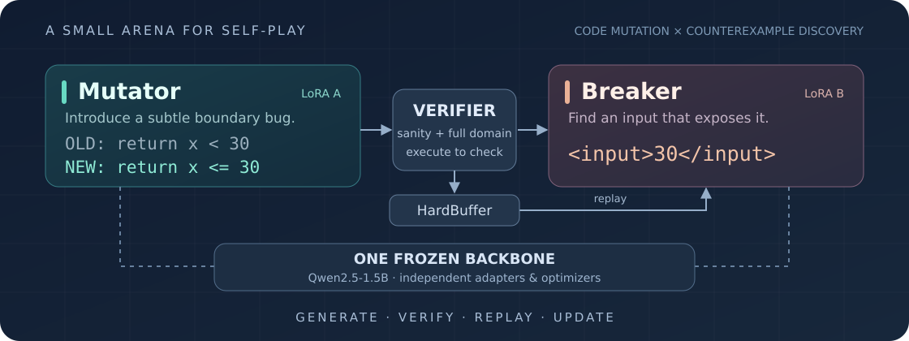
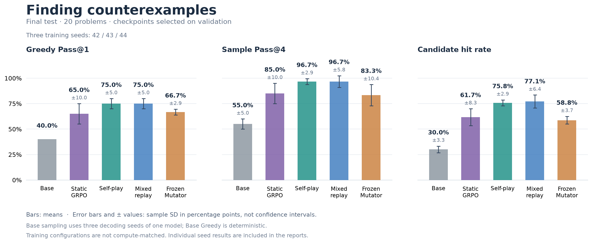
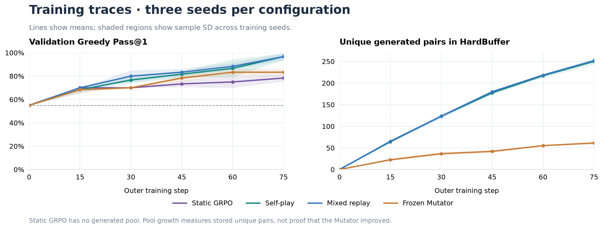

<div align="center">

# ⚔️ nano-CodeSelfPlay

**One Role Injects Subtle Bugs. The Other Hunts Down Counterexamples.**  
*Dual-LoRA Adversarial Code Self-Play on a Single Frozen 1.5B Backbone with Verifiable Execution Rewards*

[](./LICENSE)
[](https://www.python.org/)
[](https://pytorch.org/)
[](https://huggingface.co/Qwen/Qwen2.5-1.5B)
[](./tests)

**[🇨🇳 中文说明](./README.md) | [🇬🇧 English Documentation](./README_en.md)**

[Key Results](#key-results) · [Real Self-Play Case](#real-case) · [Interactive Demo](#demo) · [How It Works](#how-it-works) · [Quick Start](#quick-start) · [Reproduce Experiments](#reproduce)

</div>

<p align="center">
  
</p>

---

## 🎯 Research Question

> **Without any human-written buggy program pairs (`anchor_ratio=0`), can mutations synthesized by a 1.5B model itself train an effective counterexample-finding policy?**

**`nano-CodeSelfPlay`** turns this question into a clean, reproducible single-GPU experiment:
- **`Mutator` (Bug Injector LoRA)**: Takes a clean reference function `f_ref(x)` and proposes a single-line patch (`OLD: ... / NEW: ...`) to produce `f_mut(x)` that **must pass all routine `sanity_inputs` (stealth check)** while diverging on at least one boundary input in the domain;
- **`Breaker` (Counterexample Hunter LoRA)**: Inspects `(f_ref, f_mut)` and outputs an integer input `x` where `f_ref(x) != f_mut(x)`;
- **Isolated Sandbox & `HardBuffer`**: A restricted Python subprocess verifies AST safety, stealth on sanity inputs, and domain-wide divergence, storing challenging mutations in a prioritized replay buffer to drive alternating GRPO updates.

> [!IMPORTANT]
> **Key Findings Across 4 Regimes × 3 Seeds (12 Complete Runs)**:
> 1. **Zero-Human-Bug Self-Play Outperforms Both Base and Curated Static GRPO**: Training purely on self-generated mutations (`anchor_ratio=0`) lifts held-out test **Greedy Pass@1** from **40.00%** (Base) to **75.00% ± 5.00%**, **Sample Pass@4** from **55.00% ± 5.00%** to **96.67% ± 2.89%**, and **Candidate Hit Density** to **75.83% ± 2.89%**—decisively surpassing `Static GRPO` trained on 60 human-curated bug pairs (**65.00% ± 10.00%** Greedy, **85.00% ± 10.00%** Pass@4).
> 2. **Rigorous Ablation (Co-evolution vs. Post-Warmup Frozen Mutator)**: Freezing the Mutator's weights after 5 warmup steps (while continuing to sample new problems from it) reaches **66.67% ± 2.89%** Greedy Pass@1 (**83.33% ± 10.41%** Pass@4). Full co-evolution with parameterized boundary synthesis and sandbox witness guided rescue adds **+8.33%** on Greedy Pass@1, **+13.34%** on Pass@4, and **+17.08%** on Candidate Hit Density (**75.83%** vs. **58.75%**).

---

<a id="key-results"></a>
## 📊 Key Results

All experiments use `Qwen/Qwen2.5-1.5B` for 75 outer steps, evaluating every 15 steps on 20 validation problems to select `checkpoint-best` by validation Greedy Pass@1 (keeping the earliest step on ties), and finally evaluating on 20 held-out test problems.

| Regime | Validation Best | Test Greedy Pass@1 | Test Sample Pass@4 | Candidate Hit Density |
| :--- | ---: | ---: | ---: | ---: |
| **Base (`Qwen2.5-1.5B`)** | 55.00% | 40.00% | 55.00 ± 5.00% | 30.00 ± 3.31% |
| **Static GRPO (60 curated bug pairs)** | 78.33 ± 2.89% | 65.00 ± 10.00% | 85.00 ± 10.00% | 61.67 ± 8.32% |
| **Self-play (`anchor_ratio=0`)** | 96.67 ± 2.89% | 75.00 ± 5.00% | 96.67 ± 2.89% | 75.83 ± 2.89% |
| **Mixed replay (`anchor_ratio=0.1`)** | 96.67 ± 2.89% | 75.00 ± 5.00% | 96.67 ± 5.77% | 77.08 ± 6.41% |
| **Frozen after warmup (5 steps)** | 83.33 ± 2.89% | 66.67 ± 2.89% | 83.33 ± 10.41% | 58.75 ± 3.75% |

- Values show **Mean ± Sample SD (`ddof=1`)** across seeds `42, 43, 44`.
- Full per-seed metrics, AdamW step audits, and provenance hashes are in [`reports/v2_experiment_summary.md`](./reports/v2_experiment_summary.md), [`reports/runs/`](./reports/runs/), and [`reports/checkpoint_audit.json`](./reports/checkpoint_audit.json).

<p align="center">
  
</p>

---

<a id="real-case"></a>
## 🔬 A Real Self-Play Mutation Case

Discovered at Step 5 of pure self-play (Seed 42, `HardBuffer` entry `97575e864ed09c78`, stored in [`reports/case_study.json`](./reports/case_study.json)):

```python
# 1. Clean Reference Function (Sanity Inputs: [0, 25, 40])
def f_ref(x: int) -> bool:
    return x == 15

# 2. Mutator's Self-Generated Mutation
def f_mut(x: int) -> bool:
    return x == 15 or x == 20

# 3. Sandbox Verification:
#    On sanity inputs [0, 25, 40], both return False (passes stealth check!).
#    Across the entire domain [0, 50] (51 integers), x = 20 is the ONLY witness (1.96% sparsity).
assert f_ref(20) != f_mut(20)
```

---

<a id="demo"></a>
## 🎮 Interactive Showcase (`demo.py`)

Run [`demo.py`](./demo.py) in either **instant CPU sandbox replay mode (`--offline`)** or **live GPU Dual-LoRA inference mode (`--live`)**:

```bash
# Mode 1: Instant zero-GPU sandbox replay (replays HardBuffer case study & test benchmark comparison)
python demo.py --offline

# Mode 2: Live GPU Dual-LoRA inference (watch Mutator inject bugs & Breaker hunt counterexamples)
python demo.py --live --num_cases 3
```

---

<a id="how-it-works"></a>
## ⚙️ How It Works

| Component | Implementation Details |
| :--- | :--- |
| **One Base, Two Isolated LoRAs** | Shared frozen `Qwen2.5-1.5B` with separate `mutator` and `breaker` LoRA adapters and independent AdamW optimizers (verified for zero cross-role gradient leakage) |
| **Compact Action Spaces** | `Mutator` emits 1-shot `OLD: / NEW:` line edits (32 tokens); `Breaker` emits `<input>INTEGER</input>` (24 tokens) |
| **4-Stage Sandbox Gate** | Mutations must pass: (1) non-trivial edit $\to$ (2) AST safety whitelist $\to$ (3) 100% match on `sanity_inputs` $\to$ (4) domain-wide divergence check |
| **Sweet-Spot Curriculum Reward** | Rewards `Mutator` highest when Breaker solve rate $p_{\text{solve}} \in (0, 0.50]$ early on, tightening to $(0, 0.35]$ after Step 30 |
| **Prioritized `HardBuffer`** | Samples problems weighted by low historical Breaker solve rate, low witness sparsity, and low replay count |
| **Dynamic Variance Rescue** | If a sampled hard problem yields all-zero Breaker rewards (zero variance), triggers a fallback rollout on a solvable buffer/anchor task |

<p align="center">
  
</p>

---

<a id="quick-start"></a>
## 🚀 Quick Start

```bash
git clone https://github.com/littlelei0103/nano-CodeSelfPlay.git
cd nano-CodeSelfPlay

conda create -n nano-grpo python=3.11 -y
conda activate nano-grpo
pip install -r requirements.txt

# Run the 60-test verification suite
python -m unittest discover -s tests -v

# Run the instant terminal showcase
python demo.py --offline
```

---

<a id="reproduce"></a>
## 🔁 Reproduce Experiments & Figures

```bash
# 1. Rebuild validated summary tables and plots directly from bundled raw reports (no GPU needed)
python scripts/aggregate_all_reports.py --update-readme
python scripts/plot_comparison.py

# 2. Run the 4 training regimes (replace --seed with 42, 43, 44)
python train_selfplay.py --total_steps 75 --eval_interval 15 --mutator_warmup_steps 5 --anchor_ratio 0 --seed 42 --output_dir checkpoints_v2_pure
python train_selfplay.py --total_steps 75 --eval_interval 15 --mutator_warmup_steps 5 --anchor_ratio 0.1 --seed 42 --output_dir checkpoints_v2_mixed
python train_selfplay.py --total_steps 75 --eval_interval 15 --mutator_warmup_steps 5 --anchor_ratio 0 --freeze_mutator_after_warmup --seed 42 --output_dir checkpoints_v2_frozen_mutator
python train_selfplay.py --total_steps 75 --eval_interval 15 --breaker_only_static --seed 42 --output_dir checkpoints_v2_breaker_static
```

---

## 🔗 Sister Projects

- ⚡ [**nano-GRPO**](https://github.com/littlelei0103/nano-GRPO): Single-agent RLVR for program differential testing & counterexample mining (~3.4 GB VRAM, **85.00% ± 10.00%** Test Greedy Pass@1).
- 🟩 [**WordleZero**](https://github.com/littlelei0103/WordleZero): 1.5B multi-turn Wordle arena comparing information-theoretic solvers and two-stage R1-GRPO agents.

<p align="center"><sub>Small models. Short programs. Executable feedback.</sub><br><sub><a href="./LICENSE">MIT License</a></sub></p>
